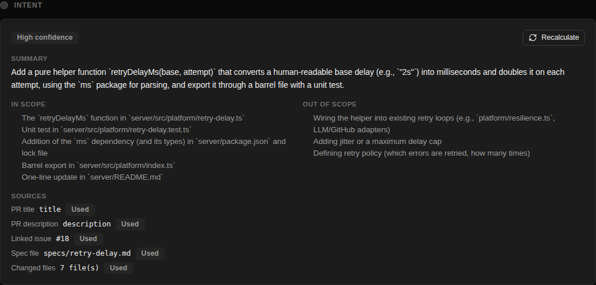

# Intent Layer — live check

Run on 2026-10-12 against the local stack on `feat/homework-3` (API :3001, web :3000, Postgres
with migration `0012` applied), with a real model: `openrouter` / `deepseek/deepseek-v4-flash`. Browser
steps were driven with Playwright; log evidence is the API's stdout (pino). No model call failed.

Test data, all in the fork: PR #11 (`test/smart-diff-groups`) got a description with
`Closes #18` and a link to `specs/retry-delay.md`, a spec added to its branch; issue #18 was
created (issues were switched on for the fork). No open PR had an empty description, so the
description of PR #10 was cleared for the "no description" scenario and restored afterwards.

| What | Result | Evidence |
|---|---|---|
| Settings → Models: the Review intent row with the flash model | PASS | Row text: "PR Review · Intent deepseek/deepseek-v4-flash — $0.030/$1.28 per 1M · 1M ctx Derives a PR’s intent and scope". `GET /settings` → `feature_models.review_intent = {"model": "deepseek/deepseek-v4-flash", "provider": "openrouter"}`. |
| PR #11 → Overview → IntentCard "none yet" | PASS | Card showed "No intent yet" and a Generate button; `GET /pulls/:id/intent` → `{"intent": null}`; opening the page logged no `llm_call`. |
| Generate → Summary, In scope, Out of scope, confidence, sources | PASS | "Generating intent..." seen, then the card below. Confidence `high`. Sources: pr_title `title` used, pr_description `description` used, linked_issue `#18` used, spec_file `specs/retry-delay.md` used, changed_files `7 file(s)` used. Exactly 1 `llm_call` line. |
| The spec's content is visible in the intent | PASS | Out of scope lists "Adding jitter or a maximum delay cap" and "Defining retry policy (which errors are retried, how many times)" — both stated only in `specs/retry-delay.md` and issue #18, not in the description. The spec was read from the PR head commit (it does not exist on `main`). |
| Reload → card from storage, no new model call | PASS | Same summary after reload; `llm_call` lines after the reload: 0. |
| Recalculate → exactly one new call | PASS | `llm_call` lines after the click: 1; `generated_at` moved 2026-10-12T11:26:24.049Z → 2026-10-12T11:26:35.599Z. |
| PR without a description and without an intent → Run review with one agent → confidence low | PASS | PR #10, body `null`, intent before: none. After the run ("General Reviewer", status `done`): confidence `low`, sources: pr_title `title` used, pr_description `description` missing (not_synced), changed_files `2 file(s)` used. The card shows "Low confidence". |
| Two separate calls in the log (classifier and review) | PASS | `llm_call` lines for that review: 1 × `intent_classifier`, 1 × `review`, one `correlationId` (`799fe9e2-705c-4e59-b1ba-3df02c450997`). Run trace steps: "Deriving PR intent (openrouter/deepseek/deepseek-v4-flash)…", "Deriving PR intent (openrouter/deepseek/deepseek-v4-flash) done (6284ms)", then "Starting review with agent "General Reviewer" (openrouter/deepseek/deepseek-v4-flash)". |
| Intent is a section of the review prompt, as untrusted data | PASS | Run trace → `prompt_assembly.user` contains `## PR intent and scope` followed by `<untrusted source="pr-intent">`; the PR title is in `<untrusted source="pr-title">`; the system message carries the scope rule. The `prompt_assembly` log line lists a `pr_intent` section with source `intent_classifier`. |
| New commit on PR #11 → resync → card marked stale | PASS | Commit `86d3cfc3` pushed to the PR branch; after the page resynced, `GET /pulls/:id/intent` → `stale: true` (stored head `bb2b6261`, PR head `86d3cfc3`); the card shows "PR changed since this was generated". Model calls on resync: 0 — the stored intent is kept, recalculation is manual. |
| Logs: only section names, numbers and ids; no keys, no diff text | PASS | Whole API log of the session (142852 bytes, 12 `prompt_assembly` and 12 `llm_call` lines): `sk-or-…` matches 0, GitHub token matches 0, `Bearer …` matches 0, diff markers found [], spec sentences found [], `prompt_preview` lines 0 (`PROMPT_LOG_VERBOSE` not set). |
| Smart Diff on PR #11 works as before | PASS | Files changed shows five groups — core[expanded=true], tests[expanded=true], wiring[expanded=true], docs[expanded=false], boilerplate[expanded=false]. `GET /pulls/:id/smart-diff`: core:server/src/platform/retry-delay.ts; tests:server/src/platform/retry-delay.test.ts; wiring:server/package.json,server/src/platform/index.ts; docs:server/README.md,specs/retry-delay.md; boilerplate:server/pnpm-lock.yaml. The new spec landed in `docs`, as a `.md` file should. |



## Log excerpts

Generate on PR #11 — one assembly line and one call line:

```
[14:26:19.346] INFO (2713971): prompt assembly (intent_classifier)
    event: "prompt_assembly"
    call: "intent_classifier"
    correlationId: "826d4707-1475-421a-acce-91eb19d96d6f"
    prId: "f1d2bde2-0cb9-4578-84e5-5a9d6f63d519"
    provider: "openrouter"
    model: "deepseek/deepseek-v4-flash"
    sections: [
      { name: "system", source: "intent_instructions", tokens: 349 },
      { name: "pr_title", source: "pull_request", tokens: 24 },
      { name: "pr_description", source: "pull_request", tokens: 134 },
      { name: "linked_issue:18", source: "github_issue", tokens: 151 },
      { name: "spec_file:specs/retry-delay.md", source: "repo_file", tokens: 281 },
      { name: "changed_files", source: "diff_outline", tokens: 294 }
    ]
    totalTokens: 1238
[14:26:24.049] INFO (2713971): llm call (intent_classifier)
    event: "llm_call"
    call: "intent_classifier"
    correlationId: "826d4707-1475-421a-acce-91eb19d96d6f"
    prId: "f1d2bde2-0cb9-4578-84e5-5a9d6f63d519"
    provider: "openrouter"
    model: "deepseek/deepseek-v4-flash"
    tokensIn: 1315
    tokensOut: 682
    costUsd: 0.00037506
    durationMs: 4703
```

Review of PR #10 (no stored intent) — classifier and review as two calls with one correlation id:

```
[14:26:42.234] INFO (2713971): prompt assembly (intent_classifier)
    event: "prompt_assembly"
    call: "intent_classifier"
    correlationId: "799fe9e2-705c-4e59-b1ba-3df02c450997"
    prId: "2c50cdcd-deb5-470d-8ff3-276536193539"
    provider: "openrouter"
    model: "deepseek/deepseek-v4-flash"
    sections: [
      { name: "system", source: "intent_instructions", tokens: 349 },
      { name: "pr_title", source: "pull_request", tokens: 24 },
      { name: "changed_files", source: "diff_outline", tokens: 67 }
    ]
    totalTokens: 442
[14:26:48.541] INFO (2713971): prompt assembly (review)
    event: "prompt_assembly"
    call: "review"
    correlationId: "799fe9e2-705c-4e59-b1ba-3df02c450997"
    prId: "2c50cdcd-deb5-470d-8ff3-276536193539"
    provider: "openrouter"
    model: "deepseek/deepseek-v4-flash"
    sections: [
      { name: "system", source: "agent_prompt", tokens: 1394 },
      { name: "task", source: "pull_request", tokens: 113 },
      { name: "pr_title", source: "pull_request", tokens: 24 },
      { name: "pr_intent", source: "intent_classifier", tokens: 156 },
      { name: "repo_map", source: "repo_index", tokens: 1516 },
      { name: "diff", source: "git_diff", tokens: 570 }
    ]
    totalTokens: 3773
[14:26:48.510] INFO (2713971): llm call (intent_classifier)
    event: "llm_call"
    call: "intent_classifier"
    correlationId: "799fe9e2-705c-4e59-b1ba-3df02c450997"
    prId: "2c50cdcd-deb5-470d-8ff3-276536193539"
    provider: "openrouter"
    model: "deepseek/deepseek-v4-flash"
    tokensIn: 466
    tokensOut: 874
    costUsd: 0.00030996
    durationMs: 6276
[14:26:53.111] INFO (2713971): llm call (review)
    event: "llm_call"
    call: "review"
    correlationId: "799fe9e2-705c-4e59-b1ba-3df02c450997"
    prId: "2c50cdcd-deb5-470d-8ff3-276536193539"
    provider: "openrouter"
    model: "deepseek/deepseek-v4-flash"
    tokensIn: 3967
    tokensOut: 119
    costUsd: 0.00041209
    durationMs: 4569
    label: "all files"
```

Head of the intent section in that run's stored prompt (run trace):

```
## PR intent and scope
<untrusted source="pr-intent">
Summary: Add a new helper function `parseRetryAfter` (likely for parsing HTTP Retry-After headers) along with its unit tests.
In scope:
- Creation of `server/src/modules/pulls/retry-after.ts` containing the…
```

## What the live run changed

The first pass of this check passed every row but showed three defects no test had caught. They
were fixed and the whole check was run again; the table above is the second pass.

- The classifier answered in Portuguese: its instructions said "answer in the language of the PR
  title". They now say to answer in English.
- Code paths written in backticks in the description (`server/src/platform/retry-delay.ts`) were
  listed under Sources as "Skipped — not a Markdown file". A backticked non-`.md` path is no
  longer treated as a spec reference; a Markdown link to a non-`.md` file still is recorded.
- GitHub returns `null` for an empty description, which the card showed as "not synced yet". The
  label now reads "empty, or not synced yet".

Not covered here: provider failures (402 / 404) — none occurred, and none was provoked.
