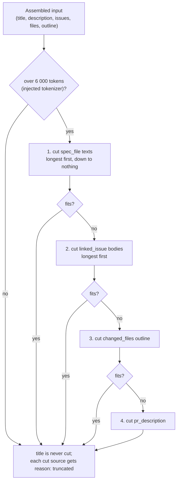

# Intent Layer

## What it is

A reviewer agent used to see the diff and the PR description but nothing that said what the PR is
*for*, so it commented on drive-by changes with the same weight as on the feature, and nobody could
see what the system believed the scope was. The Intent Layer derives that belief once per PR with a
single call to a cheap model (the `review_intent` setting), stores it in `pr_intent`, shows it on
the PR Overview tab as the **IntentCard**, and hands it to every reviewer agent as an untrusted
"PR intent and scope" section plus a trusted scope rule.

Scope is a focus hint. It trims style nits outside scope; it never hides a defect and never mutes
a CRITICAL.

## How it works

### From PR import to the review

```mermaid
sequenceDiagram
    autonumber
    participant UI as Client (Overview tab)
    participant API as Fastify API
    participant PR as pulls module
    participant IS as IntentService
    participant CS as collectSources
    participant GH as GitHubClient / GitClient
    participant LLM as LLM (review_intent model)
    participant DB as Postgres
    participant EX as ReviewRunExecutor
    participant RC as reviewer-core

    Note over PR,DB: PR sync
    PR->>DB: GET /repos/:id/pulls stores title; GET /pulls/:id backfills body (pull_requests)

    Note over UI,DB: Branch A - Overview tab
    UI->>API: GET /pulls/:id/intent (no model call)
    API->>IS: get()
    IS->>DB: getIntentRecord(prId)
    IS-->>UI: { intent: PrIntentDetail or null, stale? }
    UI->>API: POST /pulls/:id/intent/recalculate (Generate / Recalculate)
    API->>IS: recalculate() -> deriveShared()

    Note over EX,RC: Branch B - review trigger
    UI->>API: POST /pulls/:id/review
    API->>EX: executeRuns() - load diff once
    EX->>IS: ensureForReview()
    IS->>DB: getIntentRecord(prId)
    alt stored row exists (even stale)
        IS-->>EX: reused (no model call)
    else none stored
        IS->>IS: deriveShared() - one in-flight call per PR
    end

    Note over IS,LLM: derive - the one classifier call
    IS->>CS: collectSources(title, body, diff)
    CS->>GH: getIssue() for closing-keyword / same-repo issue URL
    CS->>GH: spec .md: readFileAtRef(head_sha), then getFileContent(head_sha), then readFile (clone)
    CS-->>IS: issues, files, outline (path + @@ headers), sources[]
    IS->>RC: assembleIntentPrompt() - log prompt_assembly (intent_classifier)
    IS->>RC: deriveIntent()
    RC->>LLM: completeStructured (maxRetries 0)
    LLM-->>RC: intent, in_scope, out_of_scope, confidence
    IS->>DB: saveIntentRecord -> pr_intent row (+ llm_call log line)
    IS-->>UI: PrIntentDetail (Branch A) / EX (Branch B)

    Note over EX,LLM: review with the intent
    EX->>RC: reviewPullRequest({ intent, prTitle, prDescription, ... })
    RC->>RC: assemblePrompt - "## PR intent and scope" in wrapUntrusted('pr-intent') + SCOPE_RULE in system message
    RC->>LLM: review call per chunk (llm_call: review, same correlationId)
    LLM-->>RC: findings (out-of-scope defect titled "Out of scope: ...")
    RC-->>EX: grounded findings (none dropped by scope)
```

Walk-through:

1. **Import.** The PR list route (`GET /repos/:id/pulls`) stores the title. The body stays `null`
   in `pull_requests` until `GET /pulls/:id` has refreshed the PR detail from GitHub and written
   `body`. An intent derived before that sees "no description" (source `pr_description`,
   `missing` / `not_synced`).
2. **Overview tab.** `useIntent` calls `GET /pulls/:id/intent`, which only reads the table. The
   card offers **Generate** (no row yet) or **Recalculate**, both calling
   `POST /pulls/:id/intent/recalculate`: synchronous, one model call, rate-limited to 10 per
   minute.
3. **Review trigger.** `POST /pulls/:id/review` queues runs; `ReviewRunExecutor.executeRuns` loads
   the diff once, creates a `correlationId` (a UUID) and calls `IntentService.ensureForReview`
   once for all queued agents. A stored row is reused (a moved head only flags it `stale`), else
   one classifier call is made, shown in the Live Log as its own step
   `Deriving PR intent (<provider>/<model>)`. Two concurrent triggers for the same PR share one
   in-flight call (a module-level map keyed by PR id in `intent-service.ts`).
4. **Resolving references.** `collectSources` reads only the PR's own repo (see
   [Security](#security-properties)). Issues come from `closes|fixes|resolves #N` or a same-repo
   issue URL, at most 3, through `GitHubClient.getIssue`; a number that is a pull request is
   `skipped`. Files are `.md` only, at most 3, read in this order: `git show <head_sha>:<path>`
   in the clone (`GitClient.readFileAtRef`), the GitHub contents API at `head_sha`
   (`GitHubClient.getFileContent`), then the clone's working tree (`GitClient.readFile`). A spec
   added by the PR itself is therefore found. Nothing found anywhere becomes a `missing` source
   and the call still happens. A reference that is refused (absolute path, `..`, not `.md`,
   invalid path) is never read, but `parseReferences` returns it in `rejected` and
   `collectSources` records it as a `spec_file` source with status `skipped` and the refusal
   reason, so the user can see it was ignored. A failed issue fetch becomes a `linked_issue`
   source `missing` / `fetch_failed`.
5. **Classifier.** `deriveIntent` in reviewer-core assembles the prompt and makes exactly one
   `completeStructured` call with `maxRetries: 0`, so a schema failure is an error, not a second
   call. The model is resolved only through `resolveFeatureModel(..., 'review_intent')`.
6. **Storage.** The server clamps the answer and writes the `pr_intent` row together with
   provider, model, `head_sha`, tokens, cost and `generated_at`.
7. **Reviewer.** `reviewPullRequest` receives `intent` (`summary`, `inScope`, `outOfScope`,
   `confidence`) and the PR title as its own part. Without an intent the prompt has neither the
   section nor the scope rule.

### What the classifier sees, and what it never sees



Sees (every part inside `wrapUntrusted`, system message = instructions + `INJECTION_GUARD`):

- PR title.
- PR description, first 4 000 characters.
- Up to 3 linked issues (title and body, body capped at 4 000 characters).
- Up to 3 referenced `.md` files (each at most 20 000 characters, path shown inside the block).
- A changed-file outline: `path (+a/-d)` and the raw `@@ ... @@` hunk header lines (at most 60
  files, 8 hunks per file, 160 characters per header, 6 000 characters in total).

Never sees: any hunk body line (`+`, `-` or context). `buildFileOutline` scans the raw diff for
`@@` lines only. It also never receives a URL's content: no HTTP request is made to any URL found
in PR text.

### Confidence, sources, staleness

- `confidence` is `low | medium | high`. After the model answers, the server applies one rule:
  with no description, no resolved issue and no resolved file, confidence is `low` whatever the
  model said.
- `sources` are computed by the server from what was actually resolved, never produced by the
  model. Each entry has `kind` (`pr_title`, `pr_description`, `linked_issue`, `spec_file`,
  `changed_files`), `ref`, `status` (`used`, `missing`, `skipped`) and an optional `reason`.
  Server-set reason codes:

  | `reason` | Status | Kind | Meaning |
  |---|---|---|---|
  | `not_synced` | missing | `pr_description` | PR body not yet fetched (`null`) |
  | `empty` | missing | `pr_description` | body is blank |
  | `not_found` | missing | `spec_file` | no source has the file |
  | `fetch_failed` | missing | `linked_issue` | `getIssue` threw |
  | `no_changes` | missing | `changed_files` | empty diff |
  | `too_large` | skipped | `spec_file` | over the size cap; never in the prompt |
  | `is_pull_request` | skipped | `linked_issue` | `#N` is a pull request |
  | `absolute_path` | skipped | `spec_file` | refused reference, starts with `/` |
  | `path_traversal` | skipped | `spec_file` | refused reference, has a `..` segment |
  | `not_markdown` | skipped | `spec_file` | refused reference, not `.md` |
  | `invalid_path` | skipped | `spec_file` | refused reference: backslash, control character, URL scheme, empty or `.` segment |
  | `truncated` | used | any cut source | cut to fit the input budget |

  Refused references are capped at 5 per PR and 120 characters each (control characters removed,
  `MAX_REJECTED_REFS` / `MAX_REJECTED_REF_CHARS` in
  [`constants.ts`](../server/src/modules/reviews/intent/constants.ts)); only text that looks like a
  path is listed (plain backticked words, URLs and anchors are not file references).
- Lengths are clamped after the parse: summary at most 600 characters, at most 8 list items of
  200 characters each.
- `stale` is `true` when the stored `head_sha` differs from `pull_requests.head_sha` (and the
  stored value is not null). A stale intent is still used by reviews; refreshing is manual
  (Recalculate). Editing the description does not re-derive either.

## Interfaces

### Routes

Defined in [`server/src/modules/reviews/routes.ts`](../server/src/modules/reviews/routes.ts).

| Method | Path | Returns | Model calls |
|---|---|---|---|
| GET | `/pulls/:id/intent` | `200 { intent: PrIntentDetail \| null }`; 404 for a PR outside the workspace; 422 for a non-uuid | 0 |
| POST | `/pulls/:id/intent/recalculate` | `200 { intent: PrIntentDetail }`, rate limit 10 / minute | exactly 1 |

Provider errors on recalculate (`mapProviderError` in
[`intent-service.ts`](../server/src/modules/reviews/intent/intent-service.ts)):

| Cause | HTTP | code |
|---|---|---|
| provider 402 | 402 | `llm_payment_required` |
| provider 404 (unknown model) | 502 | `llm_model_not_found` |
| provider key missing | existing config error | `config_error` |
| anything else | 502 | external-service error |

404 is never used for a provider problem: it means "PR not found". A failed call leaves the
stored row untouched. The messages are fixed per code (for example "Intent classifier call
failed"): the provider's own error text reaches neither the HTTP response, the Live Log nor the
persisted trace, because the error is mapped inside the Live Log step. The raw status code is
logged as `intent_classifier_failed` (see [Logging](#logging)).

### Contracts

[`server/src/vendor/shared/contracts/intent.ts`](../server/src/vendor/shared/contracts/intent.ts)
and its [client copy](../client/src/vendor/shared/contracts/intent.ts): `IntentConfidence`,
`IntentSource`, `PrIntentDetail` (= `Intent` + `pr_id`, `confidence`, `sources`, `provider`,
`model`, `head_sha`, `generated_at`, `stale`), `PrIntentResponse`. `Intent` (`in_scope`,
`out_of_scope`, and `intent` which the UI labels "Summary") is unchanged.

### Table `pr_intent`

[`server/src/db/schema/reviews.ts`](../server/src/db/schema/reviews.ts), migration
[`0012_nice_wolf_cub.sql`](../server/src/db/migrations/0012_nice_wolf_cub.sql) (columns added only).

| Column | Notes |
|---|---|
| `pr_id` | primary key, FK `pull_requests.id`, cascade delete |
| `intent`, `in_scope`, `out_of_scope` | the model's answer (clamped) |
| `confidence`, `sources` | server-computed |
| `provider`, `model`, `head_sha`, `generated_at` | what produced it, against which commit, when |
| `tokens_in`, `tokens_out`, `cost_usd` | the classifier call only; `agent_runs` totals stay "review calls only" |

### Settings and config

- `review_intent` in `FEATURE_MODELS` ([`platform.ts`](../server/src/vendor/shared/contracts/platform.ts)),
  default `openrouter` / `deepseek/deepseek-v4-flash`.
- `PROMPT_LOG_VERBOSE` ([`config.ts`](../server/src/platform/config.ts)).

### Configuring the model

Settings → Models → row **PR Review · Intent** (`review_intent`). Pick a provider and model; a
workspace override (`PUT /settings`) wins over the default. The default is an OpenRouter model, so
an OpenRouter API key must be saved in Settings first. Without a key, Recalculate answers with
`config_error` (the card says no API key is configured) and a review simply runs without an intent.

### Reviewer prompt

[`reviewer-core/src/prompt.ts`](../reviewer-core/src/prompt.ts) `assemblePrompt`:

- user message: `## PR intent and scope` right after `## PR description`, content inside
  `wrapUntrusted('pr-intent', ...)`; the PR title is its own `wrapUntrusted('pr-title', ...)` part
  and is no longer in the trusted task line (`taskLine` in
  [`helpers.ts`](../server/src/modules/reviews/helpers.ts)).
- system message: `SCOPE_RULE` after `INJECTION_GUARD`, only when an intent is supplied. Rule:
  severity is judged from the code alone before scope is looked at; outside scope only
  SUGGESTION-level, non-defect remarks (style, naming, nits) are withheld; a real WARNING or
  CRITICAL defect outside scope is still reported at its true severity with a title starting
  `Out of scope: `; scope never waives a CRITICAL.
- The marker is a title prefix written by the model. There is no contract field, DB column or UI
  grouping for it.

## Behaviour and edge cases

| Situation | What happens / what the user sees |
|---|---|
| No intent yet | Card shows "No intent yet" and a **Generate** button; opening the tab never spends a model call. |
| Recalculate running | Button loading, "Generating intent..." text; card `aria-busy`. |
| Intent exists | Confidence badge, optional "PR changed since this was generated" badge, Summary, In scope / Out of scope lists, Sources with status and reason. |
| Head moved since derivation | `stale` badge; reviews still reuse the row; Recalculate refreshes it. |
| Recalculate fails | Inline alert: out of credit (`llm_payment_required`), model not found (`llm_model_not_found`), no key (`config_error`), otherwise a generic retry message. The stored row is unchanged. |
| GET fails | Error state with a retry button. |
| Review, classifier fails (no key, 402, 404, schema failure) | Live Log error `PR intent unavailable - reviewing without it: <fixed message>`; the review runs without an intent section and still ends `done`. A classifier failure never fails a review. |
| Review joins a derivation already in flight | No second model call; Live Log line `PR intent derived by a concurrent request (<provider>/<model>, <confidence> confidence)`. |
| Review, stored intent | One Live Log line `PR intent reused (<provider>/<model>, <confidence> confidence)`, with a stale note when relevant; no model call. |
| PR has no body (not synced) | `pr_description` source `missing` / `not_synced`; confidence at most `low` unless an issue or file resolved. |
| Referenced file not found anywhere | Source `missing` / `not_found`; content absent from the prompt; the call still happens. |
| Referenced file too large | Source `skipped` / `too_large`; never put in the prompt. The card shows "too large, skipped". |
| Refused file reference (absolute, `..`, not `.md`, invalid) | Not read; shown as a `skipped` Spec file source with the refusal reason. |
| Linked issue fetch fails | Source `missing` / `fetch_failed` ("could not be fetched"); the call still happens. |
| Reason code the client does not know | The card shows "not available", never the raw string. |
| `#N` is a pull request | Source `skipped` / `is_pull_request`. A bare `#N` without a closing keyword is not a linked issue. |
| Over the input budget | Cuts in the order above; each cut source `reason: truncated`. |
| Out-of-scope defect found in review | Reported at its real severity as a finding titled `Out of scope: ...`. |

## Security properties

- **No SSRF.** No HTTP request goes to a URL from PR text. Issues only via `GitHubClient.getIssue`
  for the PR's own repo (owner/name must match, case-insensitive); files only from the PR's own
  repo.
- **No traversal.** `normalizeRelPath` rejects absolute paths, `..` and `.` segments, empty
  segments, backslashes, control characters, URL schemes and non-`.md` extensions before any
  read. `SimpleGitClient.readFile` additionally goes through
  [`confinePath`](../server/src/adapters/git/confine-path.ts) (realpath prefix check), so
  absolute paths, `..` and symlinks leaving the clone are rejected for every caller. Size is
  checked before the read.
- **Untrusted by construction.** Every classifier input part and the intent section of the
  review prompt go through `wrapUntrusted`, which neutralises every forged `<untrusted` or
  `</untrusted` tag (any case, inner whitespace) and sanitises the label. The system message
  carries `INJECTION_GUARD`.
- **No code path acts on scope.** No code drops, downgrades or merges a finding because of intent,
  scope or the marker.
- **Redaction.** `LOG_REDACT` in [`app.ts`](../server/src/app.ts) censors `authorization` and
  `cookie` headers and `apiKey`, `api_key`, `token`, `accessToken`, `secret`, `password` at the
  top level or one level down as `[redacted]`.

**Residual risk.** The scope rule is prompt-level only. The PR author controls `out_of_scope`
indirectly through the description, and a model that ignores both `INJECTION_GUARD` and
`SCOPE_RULE` can still be talked into downgrading or omitting a WARNING. This is a probabilistic
downgrade, not a deterministic suppression, and no code check compares findings with scope. See
[the security review](hw3/intent-security-review.md) and
[the architecture review](hw3/intent-architecture-review.md). The earlier finding that the raw
provider error message reached the HTTP client is fixed (fixed messages per code in
`mapProviderError`); the scope rule stays prompt-level and the residual risk above is unchanged.

## Logging

[`server/src/platform/prompt-log.ts`](../server/src/platform/prompt-log.ts) accepts only names,
sources, numbers and ids, so prompt text, diff, issue or spec text and keys cannot reach the log.
Each model call emits pino lines:

| `event` | Level | Fields |
|---|---|---|
| `prompt_assembly` | info | `call` (`intent_classifier` or `review`), `correlationId`, `prId`, `provider`, `model`, `sections: [{ name, source, tokens }]`, `totalTokens` |
| `llm_call` | info | the same ids plus `tokensIn`, `tokensOut`, `costUsd`, `durationMs`; for a review also `label` (chunk / file) |
| `prompt_preview` | debug | the same ids plus `previews: [{ name, text }]`, verbose only (below) |
| `intent_classifier_failed` | warn | `correlationId`, `prId`, `provider`, `model`, `status` (provider status code or `null`); no error text |

`llm_call` is one line per model call: the classifier logs one, and a map-reduce review logs one
per chunk (reviewer-core `onLlmCall`, passed by `run-executor.ts`), while `agent_runs` keeps the
summed totals.

One `correlationId` is created per review trigger (`executeRuns`) or per recalculate request
(`ReviewService.recalculateIntent`), so the classifier call and the review calls of one trigger
share it. With `PROMPT_LOG_VERBOSE=true` **and** `NODE_ENV=development` (`promptLogVerbose` in
`config.ts`), the classifier and the review each also emit a `prompt_preview` line carrying the
first 200 characters of each section; in `test` and `production` the flag is inert and no preview
text is computed.

## Where the code lives

| Path | Role |
|---|---|
| [`server/src/modules/reviews/intent/intent-service.ts`](../server/src/modules/reviews/intent/intent-service.ts) | `get`, `recalculate`, `ensureForReview`, in-flight guard, provider-error mapping, `toDetail` (staleness) |
| [`server/src/modules/reviews/intent/collect-sources.ts`](../server/src/modules/reviews/intent/collect-sources.ts) | I/O: issues, spec files, outline, `sources[]` |
| [`server/src/modules/reviews/intent/parse-references.ts`](../server/src/modules/reviews/intent/parse-references.ts) | pure: description to issue numbers and `.md` paths |
| [`server/src/modules/reviews/intent/file-outline.ts`](../server/src/modules/reviews/intent/file-outline.ts) | pure: changed files + `@@` headers, capped |
| [`server/src/modules/reviews/intent/constants.ts`](../server/src/modules/reviews/intent/constants.ts) | caps and `INTENT_FEATURE` |
| [`server/src/modules/reviews/routes.ts`](../server/src/modules/reviews/routes.ts) | the two intent routes |
| [`server/src/modules/reviews/run-executor.ts`](../server/src/modules/reviews/run-executor.ts) | pre-review step, correlation id, passes `intent` to the reviewer |
| [`server/src/modules/reviews/repository/pull.repo.ts`](../server/src/modules/reviews/repository/pull.repo.ts) | `getIntentRecord`, `saveIntentRecord` |
| [`server/src/adapters/git/confine-path.ts`](../server/src/adapters/git/confine-path.ts), [`simple-git.ts`](../server/src/adapters/git/simple-git.ts) | path confinement, `readFileAtRef` |
| [`server/src/adapters/github/octokit.ts`](../server/src/adapters/github/octokit.ts) | `getFileContent`, `getIssue` |
| [`server/src/platform/prompt-log.ts`](../server/src/platform/prompt-log.ts) | `prompt_assembly` / `llm_call` helpers |
| [`server/src/app.ts`](../server/src/app.ts) | pino `LOG_REDACT` |
| [`reviewer-core/src/intent/derive-intent.ts`](../reviewer-core/src/intent/derive-intent.ts) | `assembleIntentPrompt`, `deriveIntent`, 6 000-token budget |
| [`reviewer-core/src/prompt.ts`](../reviewer-core/src/prompt.ts) | `SCOPE_RULE`, `wrapUntrusted`, intent and title sections |
| [`client/src/app/repos/[repoId]/pulls/[number]/_components/IntentCard/`](<../client/src/app/repos/[repoId]/pulls/[number]/_components/IntentCard/>) | the card |
| [`client/src/app/repos/[repoId]/pulls/[number]/_components/OverviewTab/OverviewTab.tsx`](<../client/src/app/repos/[repoId]/pulls/[number]/_components/OverviewTab/OverviewTab.tsx>) | mounts the card with the hooks |
| [`client/src/lib/hooks/intent.ts`](../client/src/lib/hooks/intent.ts) | `useIntent`, `useRecalculateIntent` |
| [`client/messages/en/intent.json`](../client/messages/en/intent.json) | all card strings |

## Related

- Specs: [server](../server/specs/intent-layer.md), [client](../client/specs/intent-layer.md);
  review cycle: [`server/specs/review-flow.md`](../server/specs/review-flow.md).
- Reviews: [security](hw3/intent-security-review.md), [architecture](hw3/intent-architecture-review.md),
  [plan verification](hw3/intent-plan-verification.md).
- Tests: [`server/test/intent.it.test.ts`](../server/test/intent.it.test.ts),
  [`server/test/intent-contracts.test.ts`](../server/test/intent-contracts.test.ts),
  [`server/test/log-redact.test.ts`](../server/test/log-redact.test.ts),
  [`server/src/platform/prompt-log.test.ts`](../server/src/platform/prompt-log.test.ts),
  [`reviewer-core/test/derive-intent.test.ts`](../reviewer-core/test/derive-intent.test.ts),
  [`reviewer-core/test/intent-prompt.test.ts`](../reviewer-core/test/intent-prompt.test.ts),
  [`IntentCard.test.tsx`](<../client/src/app/repos/[repoId]/pulls/[number]/_components/IntentCard/IntentCard.test.tsx>).
